# SyRH user guide

SyRH is the human resources management system of the ARPTC. This guide explains how to sign in,
find your way around, and use the screens that are available today.

> **Where the application stands (November 2026).** The foundations are in place: sign-in,
> profiles, the audit log and the reference data (organisation, sites, classification). The
> business modules (Agents, Carrière, Présences, Paie, Social, Formation) appear in the menu but
> are not built yet. The dashboard shows demonstration figures only.

The application's screens are in French. This guide quotes their labels as they appear on screen,
in **bold**.

## Contents

1. [Signing in](#1-signing-in)
2. [The dashboard](#2-the-dashboard)
3. [Finding your way around](#3-finding-your-way-around)
4. [Your account: password and signing out](#4-your-account-password-and-signing-out)
5. [Reference data (Référentiels)](#5-reference-data-référentiels)
6. [The audit log (Journal d'audit)](#6-the-audit-log-journal-daudit)
7. [System status (Système)](#7-system-status-système)
8. [Using SyRH on a smaller screen](#8-using-syrh-on-a-smaller-screen)
9. [Common questions](#9-common-questions)

---

## 1. Signing in

1. Open SyRH in your browser. If you are not signed in, you land on the **Connexion** page.
2. Type your **Identifiant** (user name) and your **Mot de passe** (password). The eye icon in the
   password field shows what you typed.
3. Click **Se connecter**.

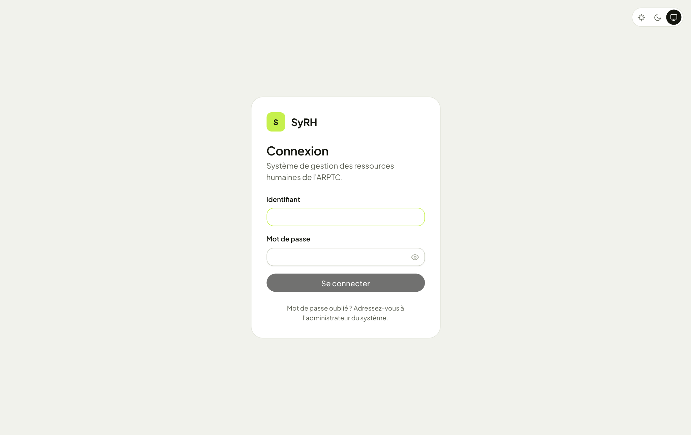

If the user name or password is wrong, a red message says so and the password field is cleared.
Type it again.

**Tips**

- If you opened a link to a specific page before signing in, SyRH takes you to that page once you
  are signed in.
- Forgotten password? SyRH has no reset link: ask the system administrator
  (**Administrateur système**) to set a new one.

## 2. The dashboard

After signing in you arrive on the **Tableau de bord** (dashboard). Every signed-in user can see
it, whatever their profile.

The **Données de démonstration** label means the figures are examples: they are not calculated
from real data yet. The cards preview what the dashboard will show once the business modules are
built:

- **Effectif total**, **Masse salariale**, **Taux de présence** and **Bons de soins émis**, with
  the change since last month;
- **Effectif par direction** and **Répartition par catégorie**;
- **Échéances à venir** (upcoming deadlines: end of probation, retirement, ...);
- **Clôture de la paie** (payroll closing progress) and **Derniers mouvements** (latest
  personnel movements), further down the page.

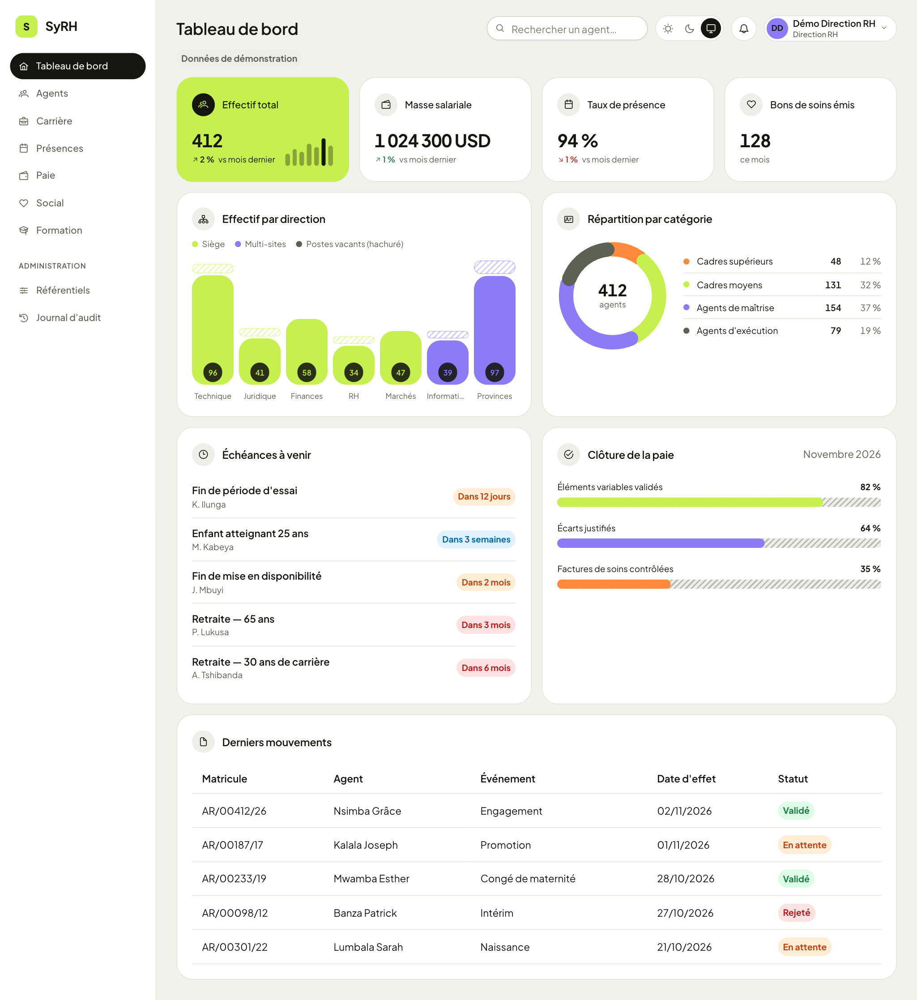

If the dashboard shows **Aucun profil ne vous est attribué**, your account has no profile yet and
you can open nothing else. Ask the system administrator to give you a profile.

## 3. Finding your way around

### The side menu

The menu on the left lists the modules you may open. It depends on your **profile** (your role
in the HR department). Modules you have no access to are simply not shown.

The menu has two parts:

- the business modules: **Tableau de bord**, **Agents**, **Carrière**, **Présences**, **Paie**,
  **Social**, **Formation**;
- under **Administration**: **Référentiels**, **Journal d'audit**, **Système**, **Design**.

The module you are in is highlighted in black. Click the **SyRH** logo to go back to the
dashboard.

For example, a user with the **Social** profile only sees Agents, Social and Référentiels:

Which profile sees which module:

| Profile | Modules in the menu (besides Tableau de bord) |
| --- | --- |
| Gestion de carrière (and its Chef de service) | Agents, Carrière, Référentiels |
| Administration du personnel (and its Chef de service) | Agents, Présences, Référentiels |
| Rémunération (and its Chef de service) | Agents, Paie, Référentiels |
| Social (and its Chef de service) | Agents, Social, Référentiels |
| Formation (and its Chef de service) | Agents, Formation, Référentiels |
| Direction RH | Agents, Carrière, Présences, Paie, Social, Formation, Référentiels, Journal d'audit |
| Auditeur | Agents, Carrière, Présences, Formation, Référentiels, Journal d'audit |
| Administrateur système | Référentiels, Journal d'audit, Système, Design |

Salaries are visible to Rémunération and Direction RH only, and medical care details to Social
and Direction RH only.

### Modules that are not built yet

Agents, Carrière, Présences, Paie, Social and Formation open a page that says
**Ce module n'est pas encore développé** (this module is not built yet).

### "Accès refusé"

If you type the address of a module that your profile does not include (or follow a link to
one), SyRH shows **Accès refusé** instead of the page. Click **Retour au tableau de bord** to go
back. If you need the module for your work, ask the system administrator.

### The top bar

From left to right, the top bar shows:

- the **title** of the page you are on;
- **Rechercher un agent…**, the agent search field. It is not active yet: it will work once the
  Agents module is built;
- the **theme** switch (see below);
- the **notifications** bell, not active yet;
- your **name and profile**, which opens your account menu (see
  [section 4](#4-your-account-password-and-signing-out)).

### Light and dark theme

Use the three round buttons in the top bar to choose how SyRH looks:

- the sun: **Thème clair** (light);
- the moon: **Thème sombre** (dark);
- the screen: **Thème du système**, which follows your computer's setting. This is the default.

SyRH remembers your choice in this browser. The same switch is at the top right of the sign-in
page.

## 4. Your account: password and signing out

Click your name at the top right to open the account menu. It has two entries:
**Changer le mot de passe** and **Se déconnecter**.

### Change your password

1. Click your name, then **Changer le mot de passe**.
2. Type your **Mot de passe actuel** (current password).
3. Type the **Nouveau mot de passe** (new password), then type it again in
   **Confirmer le nouveau mot de passe**.
4. Click **Enregistrer**.

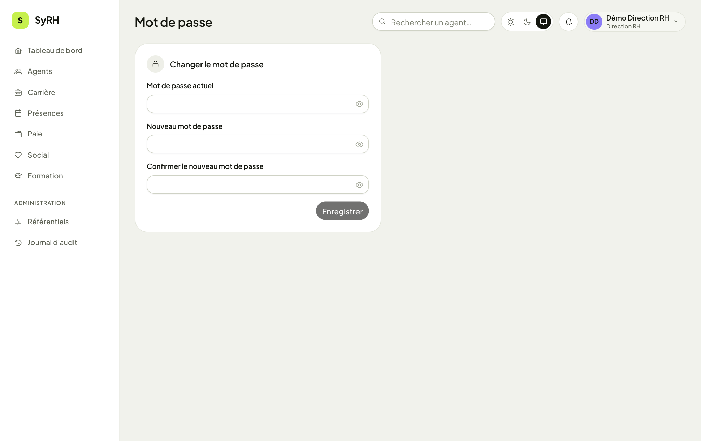

A green message, **Mot de passe modifié**, confirms the change. You stay signed in here, but
SyRH signs you out everywhere else, for example on another computer.

The new password must:

- be at least 8 characters long;
- not be made of digits only;
- not be a common password;
- not look too much like your user name or your name.

If it does not meet these rules, or the two new passwords differ, a message under the field says
why.

### Sign out

Click your name, then **Se déconnecter**. You are back on the **Connexion** page. Sign out when
you leave a shared computer.

## 5. Reference data (Référentiels)

**Référentiels** holds the reference data the other modules rely on: the organisation chart, the
sites and the job classification. Every profile can open it.

The screen is **read-only**: it shows the data but does not change it. Changes are made by the
**Administrateur système** and **Gestion de carrière** profiles, in the administration site
(see [Who changes the reference data](#who-changes-the-reference-data)).

The screen has three tabs: **Organisation**, **Sites** and **Classification**.

### Organisation

The **Organisation** tab shows the ARPTC's structure as a tree: directions, then départements,
services and bureaux. Each row shows the unit's **Code**, its **Type**, its **Site** and the
dates it was opened (**Ouverture**) and, if it no longer exists, closed (**Fermeture**).

1. Click the arrow in front of a unit to show or hide the units under it.
2. Click **Tout déplier** to open the whole tree, or **Tout replier** to close it.

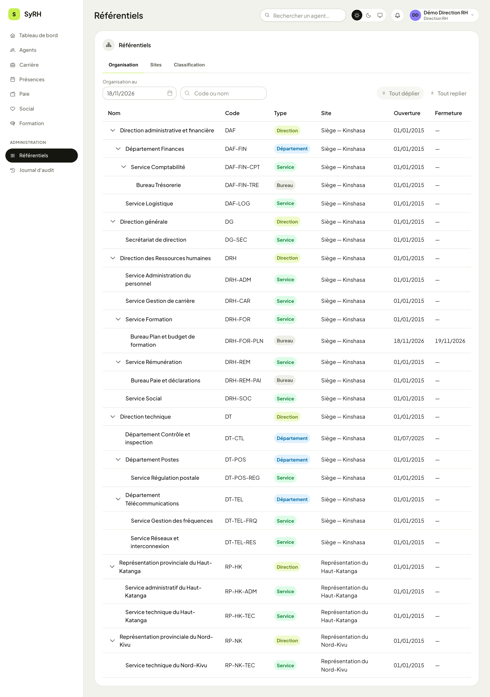

**Search for a unit.** Type part of a code or name in the **Code ou nom** field. The tree keeps
only the matching units, with the units above them so you can see where they sit.

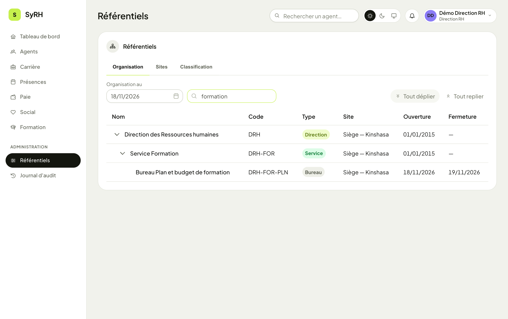

**See the organisation at another date.** The organisation changes over time: a reorganisation
closes some units and opens new ones. By default the tree shows the organisation as it is today.

1. Click the date in the **Organisation au** field.
2. Pick a date in the calendar. Click the month or year at the top of the calendar to jump
   further back.

The tree now shows the units that existed on that date. For example, in June 2024 the Direction
technique still had a **Service Contrôle** (closed on 1 July 2025), and not the
**Département Contrôle et inspection** that replaced it.

### Sites

The **Sites** tab lists the ARPTC's sites: the head office (**Siège**) in Kinshasa and the
provincial representations, with their **Code**, **Nom**, **Ville** and **Statut**.

Turn on **Afficher les sites fermés** to also list sites that have been closed.

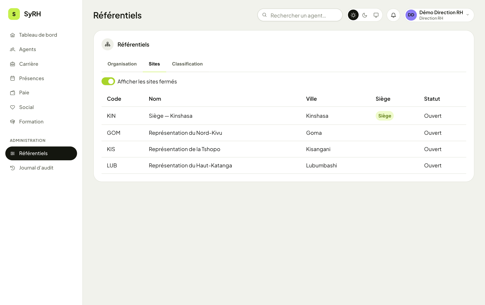

### Classification

The **Classification** tab shows the job classification grid as a tree:

- **Catégorie** (category), for example Cadres de direction or Cadres de collaboration;
- **Grade**, inside a category;
- **Échelon** (step), inside a grade.

The **Rang** column gives the order within the level above: the higher the rank, the higher the
position.

The search field, **Tout déplier** and **Tout replier** work as in the Organisation tab.

**See the grid at another date.** When the grid is reformed, the old grade is closed and a new
one takes over from the reform date. Change the **Classification au** date to see the grid as it
was. In the demonstration data, **Attaché de 2e classe** had 3 échelons until 1 January 2025.
Since then **Attaché de 2e classe (grille 2025)** has 5.

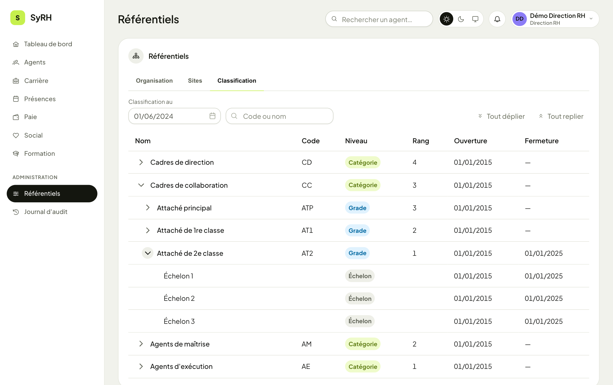

The Organisation and Classification tabs each keep their own date and search, so changing one
does not move the other.

### Who changes the reference data

Accounts with the **Administrateur système** or **Gestion de carrière** profile, and with
staff status (**Statut équipe**), change the reference data in the administration site, at
`/admin/` (the same address as SyRH, followed by `/admin/`). A reorganisation or a reform is
recorded by closing the old unit or grade on a date and opening the new one, never by deleting
it, so the history stays readable. Every change is recorded in the
[audit log](#6-the-audit-log-journal-daudit).

## 6. The audit log (Journal d'audit)

The **Journal d'audit** records every change made in SyRH: who made it, when, on which record,
and the values before and after. Nobody can change or delete an entry.

Who can open it: **Auditeur**, **Direction RH** and **Administrateur système**. Each sees only
the entries of the modules their profile may open, plus changes to user accounts (**Comptes**).

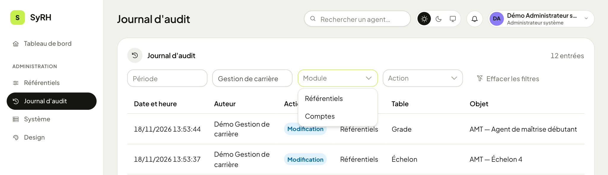

### Find an entry

Use the filters above the list. You can combine them:

- **Période**: pick a start date and an end date in the calendar;
- **Auteur**: type part of the name of the person who made the change;
- **Module**: for example Référentiels or Comptes;
- **Action**: for example Création (creation) or Modification.

The number of matching entries shows at the top right. Click **Effacer les filtres** to see all
entries again. The newest entries come first. Use the page numbers at the bottom to see older
ones.

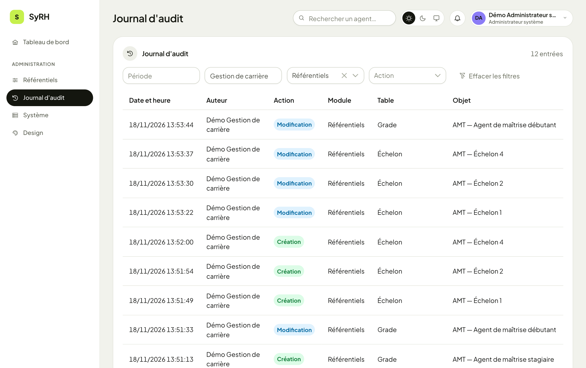

### See the detail of a change

Click a row. The **Détail de l'entrée** panel opens on the right, with:

- the action, the record concerned, its table and module;
- the date and time, and the author;
- a table of the fields that changed, with the value **Avant** (before) and **Après** (after).

Passwords are always masked (••••••): the log only records that one changed.

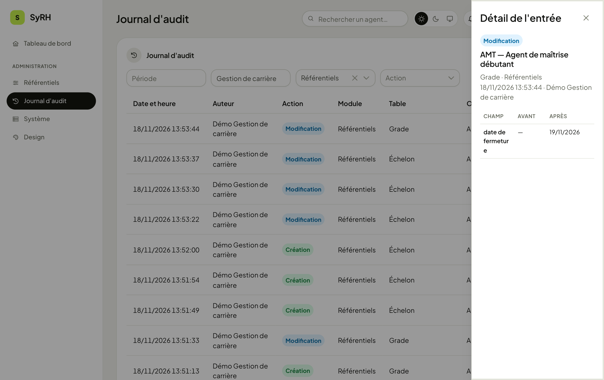

Close the panel with the cross at its top right, or press Échap (Escape).

## 7. System status (Système)

For the **Administrateur système** only. **Système** shows whether the application is running:
the state of the API and the database version. If SyRH cannot reach its server, the page says
**API injoignable** (API unreachable).

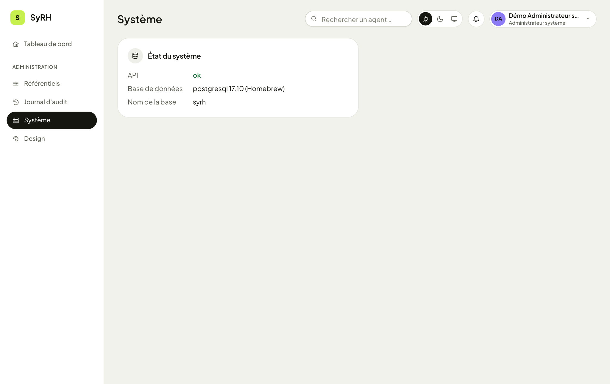

The **Design** entry, also for the system administrator, shows the colours and components SyRH is
built with. End users do not need it.

## 8. Using SyRH on a smaller screen

On a narrow window or a tablet, the side menu shrinks to icons. Hover over an icon to see the
module's name. The agent search field is hidden, and the buttons of the Référentiels screen move
to their own line.

## 9. Common questions

**I forgot my password.**
Ask the system administrator to set a new one, then change it from your account menu
([section 4](#change-your-password)).

**A module I need is not in my menu.**
Your profile does not include it. Ask the system administrator to review your profile.

**I see "Aucun profil ne vous est attribué".**
Your account exists but has no profile yet. Ask the system administrator to give you one.

**A page says it could not load ("n'a pas pu être chargé"), or "Connexion impossible pour le
moment".**
The server did not answer. Wait a moment and try again. If it continues, tell the system
administrator.

**I cannot change anything in Référentiels.**
That is expected: the screen is read-only. Changes are made in the administration site by the
Administrateur système and Gestion de carrière profiles.

**Can I change or delete an audit log entry?**
No. The log is permanent, and nobody can change it, not even the administrator.

---

*Screenshots taken on 18 November 2026 with the demonstration data and accounts
(`create_demo_users`, `create_demo_organisation`, `create_demo_classification`). To retake them,
see `docs/capture_screenshots.py`.*
