# SyRH user guide

SyRH is the human resources management system of the ARPTC. This guide explains how to sign in,
find your way around, and use the screens that are available today.

> **Where the application stands (November 2026).** The foundations are in place: sign-in,
> profiles, the audit log and the reference data (organisation, sites, classification, job
> functions, contract types, supporting documents), and the scanned documents of each agent. The
> business modules (Agents, Carrière, Présences, Paie, Social, Formation) appear in the menu but
> are not built yet. The dashboard shows demonstration figures only.

The application's screens are in French. This guide quotes their labels as they appear on screen,
in **bold**.

## Contents

1. [Signing in](#1-signing-in)
2. [The dashboard](#2-the-dashboard)
3. [Finding your way around](#3-finding-your-way-around)
4. [Your account: password and signing out](#4-your-account-password-and-signing-out)
5. [Reference data (Référentiels)](#5-reference-data-référentiels)
6. [Agents' supporting documents (Pièces des agents)](#6-agents-supporting-documents-pièces-des-agents)
7. [The audit log (Journal d'audit)](#7-the-audit-log-journal-daudit)
8. [System status (Système)](#8-system-status-système)
9. [Using SyRH on a smaller screen](#9-using-syrh-on-a-smaller-screen)
10. [Common questions](#10-common-questions)

---

## 1. Signing in

1. Open SyRH in your browser. If you are not signed in, you land on the **Connexion** page.
2. Type your **Identifiant** (user name) and your **Mot de passe** (password). The eye icon in the
   password field shows what you typed.
3. Click **Se connecter**.

If the user name or password is wrong, a red message says so and the password field is cleared.
Type it again.

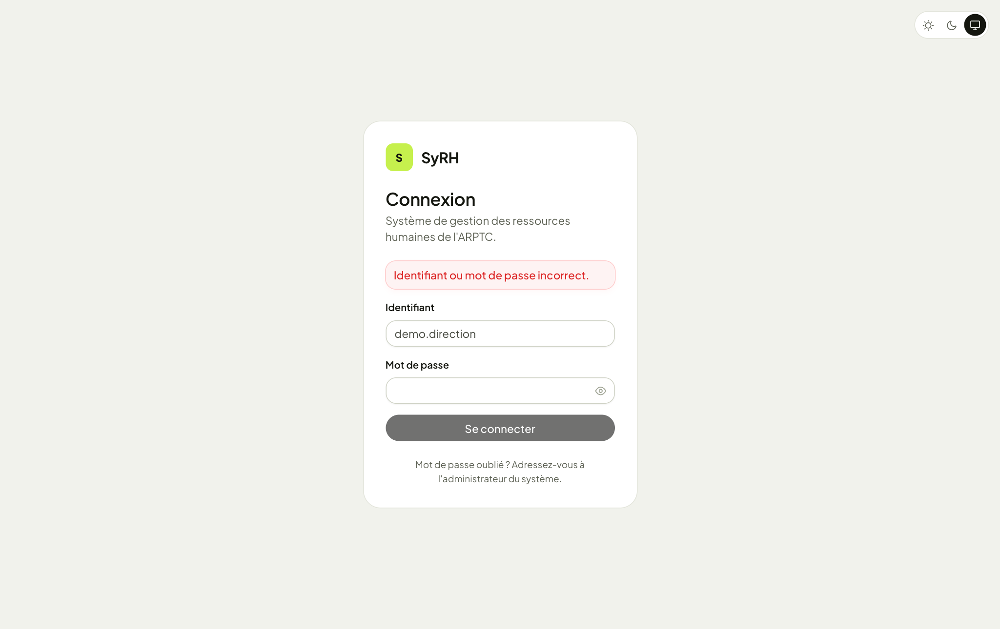

**Tips**

- If you opened a link to a specific page before signing in, SyRH takes you to that page once you
  are signed in.
- Forgotten password? SyRH has no reset link: ask the system administrator
  (**Administrateur système**) to set a new one.

## 2. The dashboard

After signing in you arrive on the **Tableau de bord** (dashboard). Every signed-in user can see
it, whatever their profile.

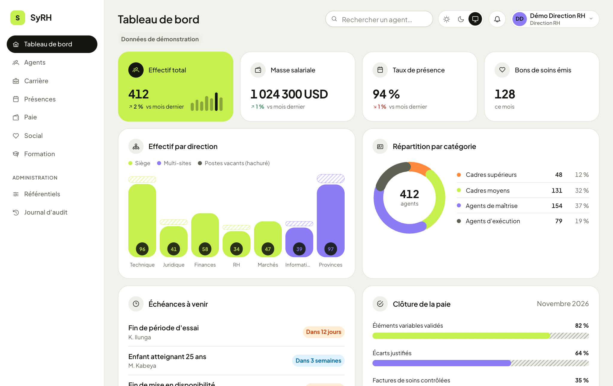

The **Données de démonstration** label means the figures are examples: they are not calculated
from real data yet. The cards preview what the dashboard will show once the business modules are
built:

- **Effectif total**, **Masse salariale**, **Taux de présence** and **Bons de soins émis**, with
  the change since last month;
- **Effectif par direction** and **Répartition par catégorie**;
- **Échéances à venir** (upcoming deadlines: end of probation, retirement, ...);
- **Clôture de la paie** (payroll closing progress) and **Derniers mouvements** (latest
  personnel movements), further down the page.

If the dashboard shows **Aucun profil ne vous est attribué**, your account has no profile yet and
you can open nothing else. Ask the system administrator to give you a profile.

## 3. Finding your way around

### The side menu

The menu on the left lists the modules you may open. It depends on your **profile** (your role
in the HR department). Modules you have no access to are simply not shown.

The menu has two parts:

- the business modules: **Tableau de bord**, **Agents**, **Carrière**, **Présences**, **Paie**,
  **Social**, **Formation**;
- under **Administration**: **Référentiels**, **Journal d'audit**, **Système**, **Design**.

The module you are in is highlighted in black. Click the **SyRH** logo to go back to the
dashboard.

For example, a user with the **Social** profile only sees Agents, Social and Référentiels:

Which profile sees which module:

| Profile | Modules in the menu (besides Tableau de bord) |
| --- | --- |
| Gestion de carrière (and its Chef de service) | Agents, Carrière, Référentiels |
| Administration du personnel (and its Chef de service) | Agents, Présences, Référentiels |
| Rémunération (and its Chef de service) | Agents, Paie, Référentiels |
| Social (and its Chef de service) | Agents, Social, Référentiels |
| Formation (and its Chef de service) | Agents, Formation, Référentiels |
| Direction RH | Agents, Carrière, Présences, Paie, Social, Formation, Référentiels, Journal d'audit |
| Auditeur | Agents, Carrière, Présences, Formation, Référentiels, Journal d'audit |
| Administrateur système | Référentiels, Journal d'audit, Système, Design |

Salaries are visible to Rémunération and Direction RH only, and medical care details to Social
and Direction RH only.

### Modules that are not built yet

Agents, Carrière, Présences, Paie, Social and Formation open a page that says
**Ce module n'est pas encore développé** (this module is not built yet). Under Agents, only
[Pièces des agents](#6-agents-supporting-documents-pièces-des-agents) is available so far.

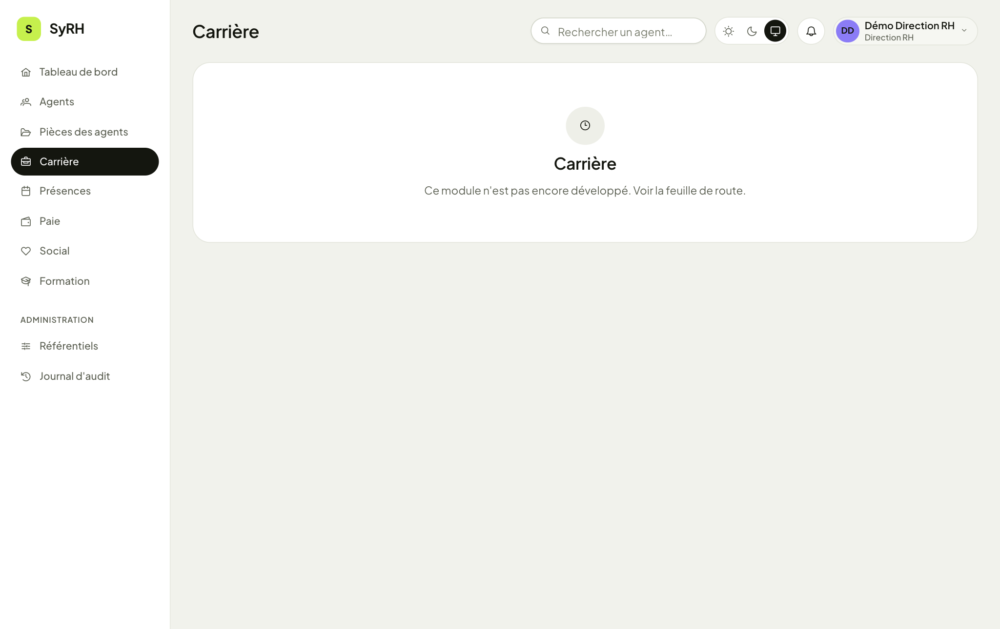

### "Accès refusé"

If you type the address of a module that your profile does not include (or follow a link to
one), SyRH shows **Accès refusé** instead of the page. Click **Retour au tableau de bord** to go
back. If you need the module for your work, ask the system administrator.

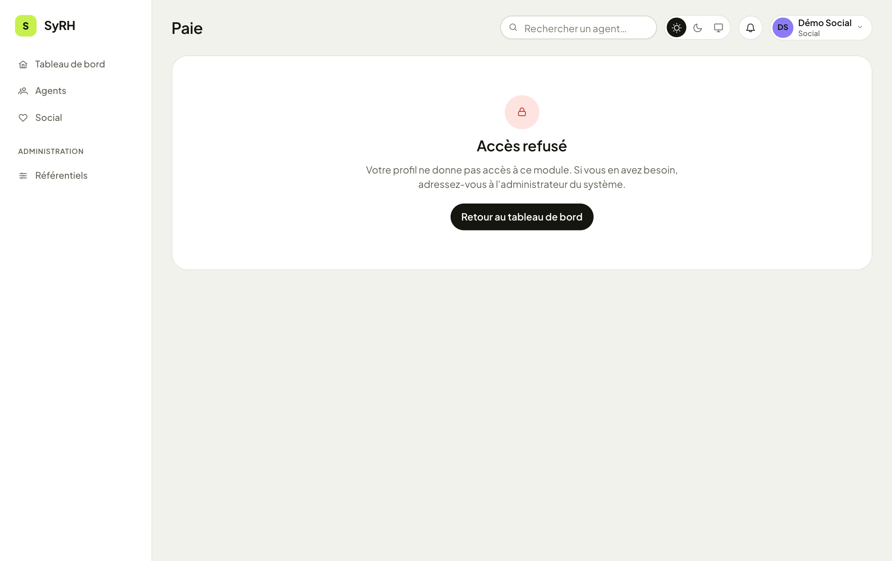

### The top bar

From left to right, the top bar shows:

- the **title** of the page you are on;
- **Rechercher un agent…**, the agent search field. It is not active yet: it will work once the
  Agents module is built;
- the **theme** switch (see below);
- the **notifications** bell, not active yet;
- your **name and profile**, which opens your account menu (see
  [section 4](#4-your-account-password-and-signing-out)).

### Light and dark theme

Use the three round buttons in the top bar to choose how SyRH looks:

- the sun: **Thème clair** (light);
- the moon: **Thème sombre** (dark);
- the screen: **Thème du système**, which follows your computer's setting. This is the default.

SyRH remembers your choice in this browser. The same switch is at the top right of the sign-in
page.

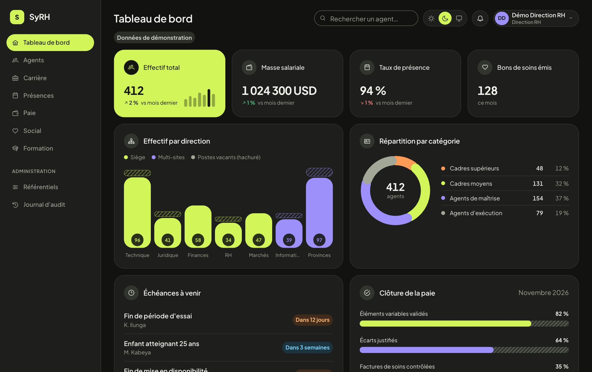

## 4. Your account: password and signing out

Click your name at the top right to open the account menu. It has two entries:
**Changer le mot de passe** and **Se déconnecter**.

### Change your password

1. Click your name, then **Changer le mot de passe**.
2. Type your **Mot de passe actuel** (current password).
3. Type the **Nouveau mot de passe** (new password), then type it again in
   **Confirmer le nouveau mot de passe**.
4. Click **Enregistrer**.

A green message, **Mot de passe modifié**, confirms the change. You stay signed in here, but
SyRH signs you out everywhere else, for example on another computer.

The new password must:

- be at least 8 characters long;
- not be made of digits only;
- not be a common password;
- not look too much like your user name or your name.

If it does not meet these rules, or the two new passwords differ, a message under the field says
why.

### Sign out

Click your name, then **Se déconnecter**. You are back on the **Connexion** page. Sign out when
you leave a shared computer.

## 5. Reference data (Référentiels)

**Référentiels** holds the reference data the other modules rely on: the organisation chart, the
sites, the job classification, the job functions, the contract types, the supporting documents
each event requires, the reasons a career stops or is suspended, the banks agents are paid
through, and the general parameters (age limits, career length). Every profile can open it.

Most people only read this screen. The editors of a list (see
[Who changes the reference data](#who-changes-the-reference-data)) also change it here, on every
tab (see [Change the reference data](#change-the-reference-data)).

The screen has nine tabs: **Organisation**, **Sites**, **Classification**, **Fonctions**,
**Types de contrat**, **Pièces justificatives**, **Sorties et suspensions**, **Banques** and
**Paramètres**. On a narrow window, use the arrows at either end of the tab bar to reach the last
ones.

### Organisation

The **Organisation** tab shows the ARPTC's structure as a tree: directions, then départements,
services and bureaux. Each row shows the unit's **Code**, its **Type**, its **Site** and the
dates it was opened (**Ouverture**) and, if it no longer exists, closed (**Fermeture**).

1. Click the arrow in front of a unit to show or hide the units under it.
2. Click **Tout déplier** to open the whole tree, or **Tout replier** to close it.

**Search for a unit.** Type part of a code or name in the **Code ou nom** field. The tree keeps
only the matching units, with the units above them so you can see where they sit.

**See the organisation at another date.** The organisation changes over time: a reorganisation
closes some units and opens new ones. By default the tree shows the organisation as it is today.

1. Click the date in the **Organisation au** field.
2. Pick a date in the calendar. Click the month or year at the top of the calendar to jump
   further back.

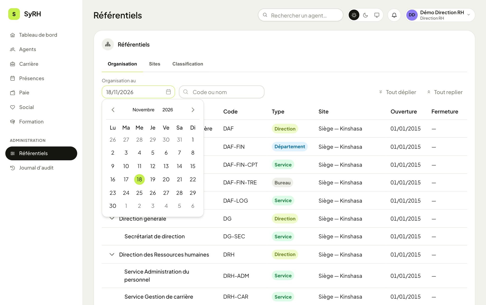

The tree now shows the units that existed on that date. For example, in June 2024 the Direction
technique still had a **Service Contrôle** (closed on 1 July 2025), and not the
**Département Contrôle et inspection** that replaced it.

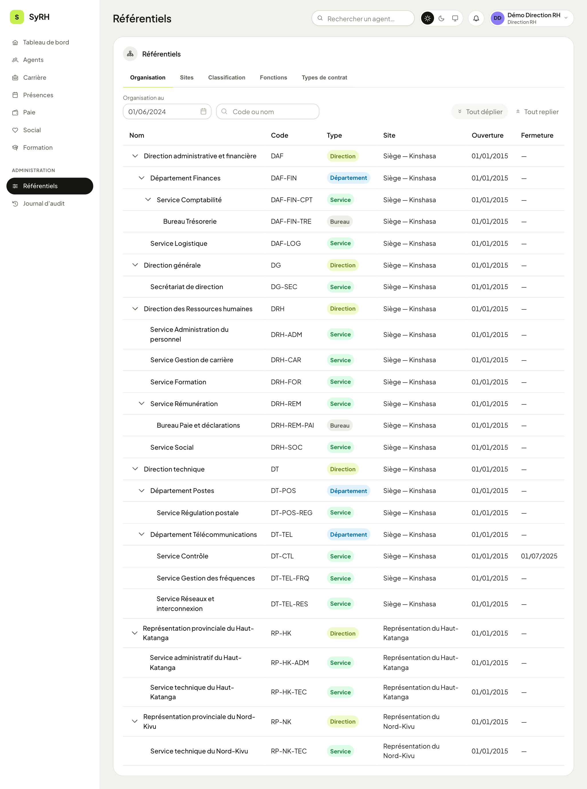

### Sites

The **Sites** tab lists the ARPTC's sites: the head office (**Siège**) in Kinshasa and the
provincial representations, with their **Code**, **Nom**, **Ville** and **Statut**.

Turn on **Afficher les sites fermés** to also list sites that have been closed.

### Classification

The **Classification** tab shows the job classification grid as a tree:

- **Catégorie** (category), for example Cadres de direction or Cadres de collaboration;
- **Grade**, inside a category;
- **Échelon** (step), inside a grade.

The **Rang** column gives the order within the level above: the higher the rank, the higher the
position.

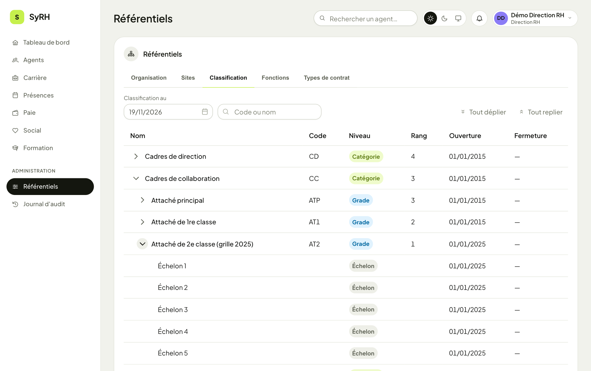

The search field, **Tout déplier** and **Tout replier** work as in the Organisation tab.

**See the grid at another date.** When the grid is reformed, the old grade is closed and a new
one takes over from the reform date. Change the **Classification au** date to see the grid as it
was. In the demonstration data, **Attaché de 2e classe** had 3 échelons until 1 January 2025.
Since then **Attaché de 2e classe (grille 2025)** has 5.

Every tab with a date keeps its own date and search, so changing one does not move the others.

### Fonctions

The **Fonctions** tab lists the job functions an agent can hold, with their **Code**, **Nom**,
**Nature**, and opening and closing dates. The nature is one of two:

- **Responsabilité**: the holder heads a unit or a team (Directeur, Chef de service, ...);
- **Exécution**: every other post (Juriste, Comptable, Chauffeur, ...).

Posts of responsibility come first, then the others, each in alphabetical order.

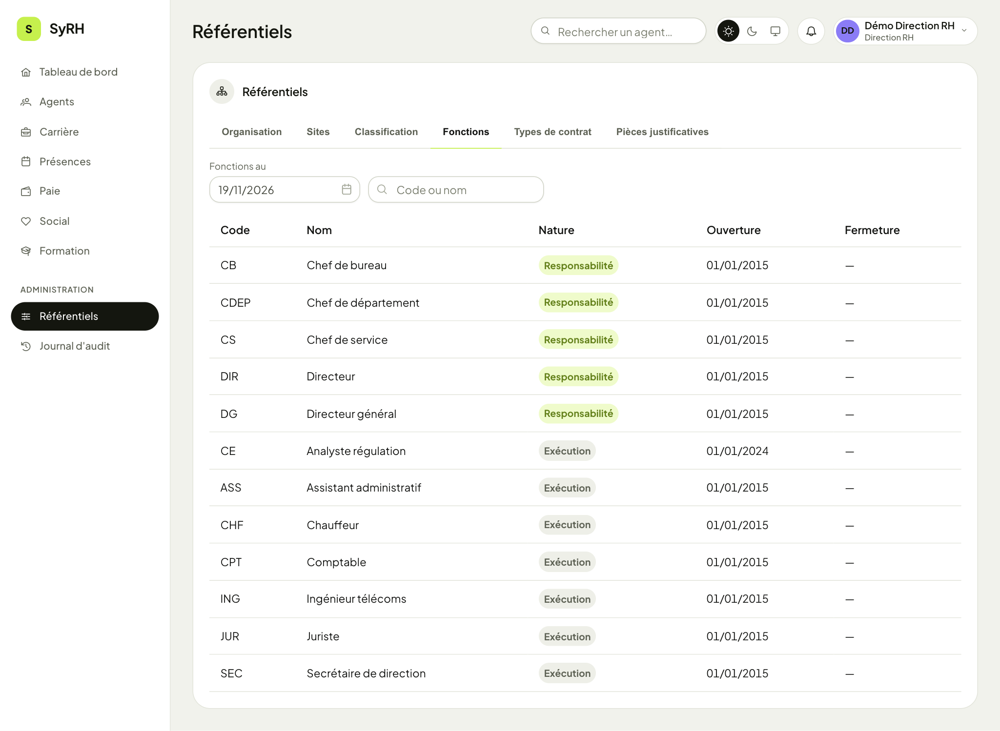

**Search for a fonction.** Type part of a code or name in the **Code ou nom** field. Capitals and
accents do not matter: "ingenieur" finds "Ingénieur télécoms".

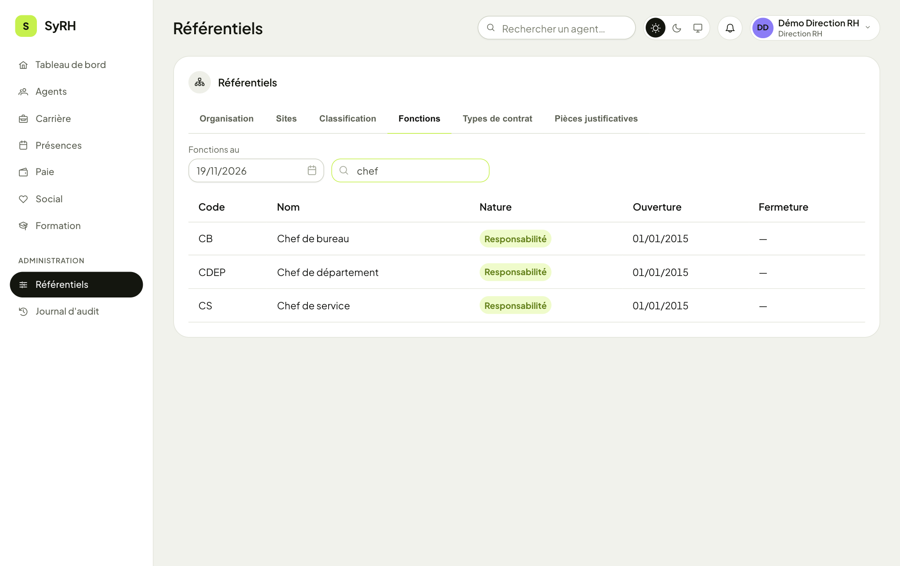

**See the fonctions at another date.** When a fonction is renamed, the old name is closed and the
new one opens on the same day, often with the same code. Change the **Fonctions au** date to see
the list as it was. In the demonstration data, **Chargé d'études** became
**Analyste régulation** on 1 January 2024.

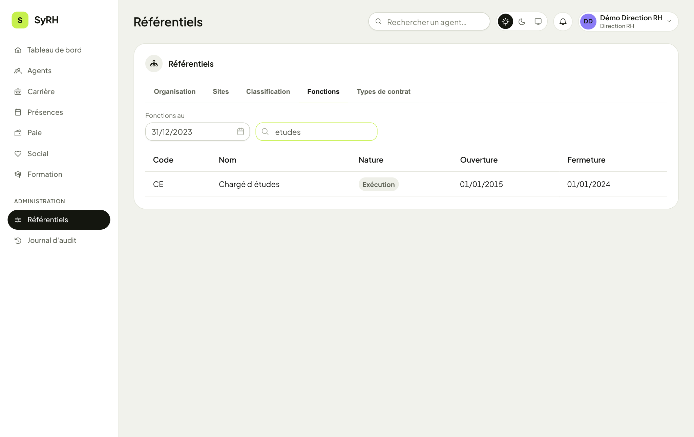

### Types de contrat

The **Types de contrat** tab lists the kinds of contract an agent can be hired on, such as
CDI, CDD, Stage and Journalier, in alphabetical order. Besides the code, name and dates, two
columns give each type's rules, as **Oui** or **Non**:

- **Durée déterminée**: a contract of this type must have an end date (a CDD or an internship,
  for example);
- **Période d'essai**: a contract of this type may start with a probation period.

These rules will apply when contracts are recorded for each agent, in a later version.

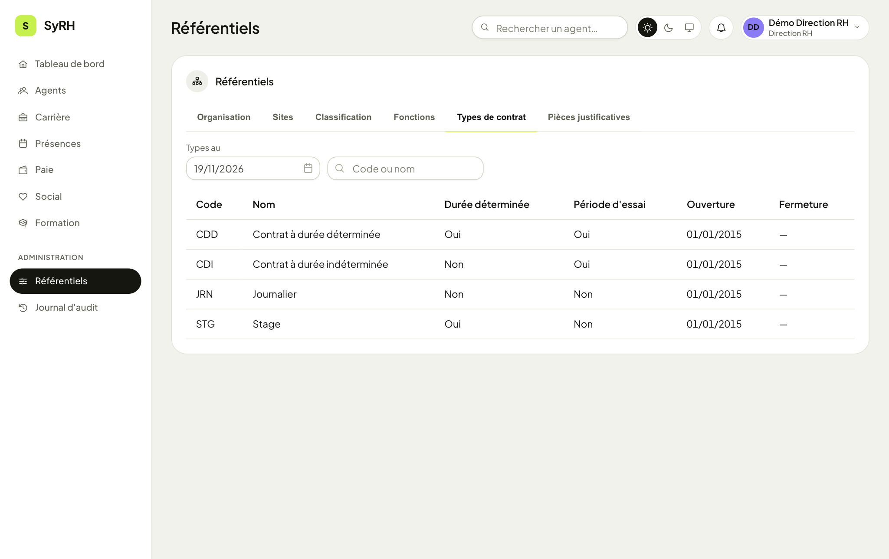

Search by code or name works as in the other tabs.

**See the types at another date.** A type that is no longer used is closed and disappears from the
list after its closing date. Change the **Types au** date to see the list as it was: in the
demonstration data, the **Contrat d'apprentissage** was used until 1 January 2023.

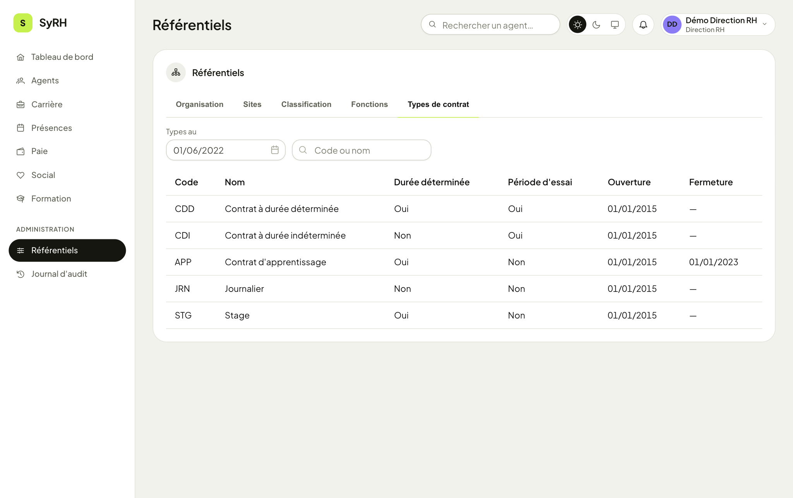

### Pièces justificatives

The **Pièces justificatives** tab answers the question "which documents must I collect for this
event?". It lists every event in an agent's career, from **Engagement** (hiring) to **Formation**
(training), with how many documents each requires.

1. Click the arrow in front of an event to see its documents, or **Tout déplier** to open them
   all.
2. Each document shows its code and an **Exigence** tag:
   - **Obligatoire**: without it, the event cannot be validated;
   - **Facultative**: it can be attached but is not required. For example, ending a dependant's
     status needs a death certificate *or* a divorce judgment, depending on the cause.

An event marked **Aucune pièce exigée** requires no document of its own. **Sortie** (exit) is
one: the document depends on the reason for leaving (a resignation letter, a death certificate),
and each reason will name its own.

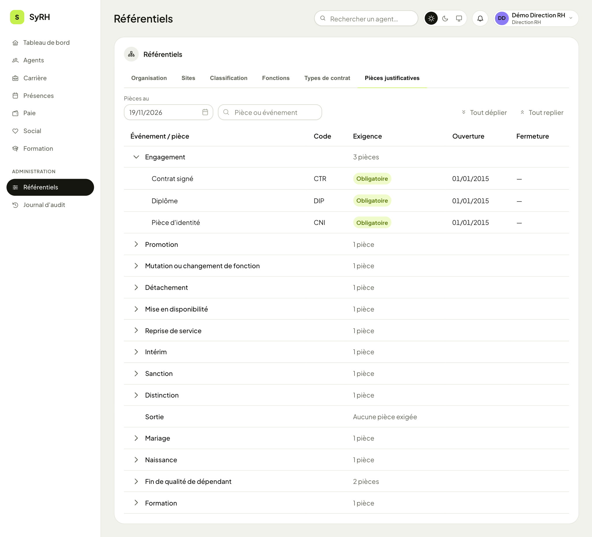

**Search.** Type the name of an event to see it with all its documents, or the name of a document
to see every event that requires it. Here, the decision is required by every career event:

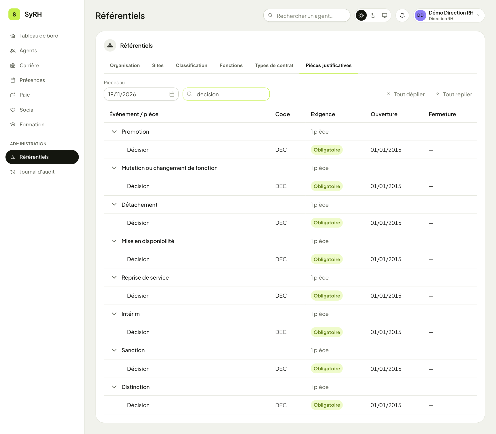

**See the documents required at another date.** Change the **Pièces au** date. In the
demonstration data, hiring required the criminal record extract until 1 January 2024:

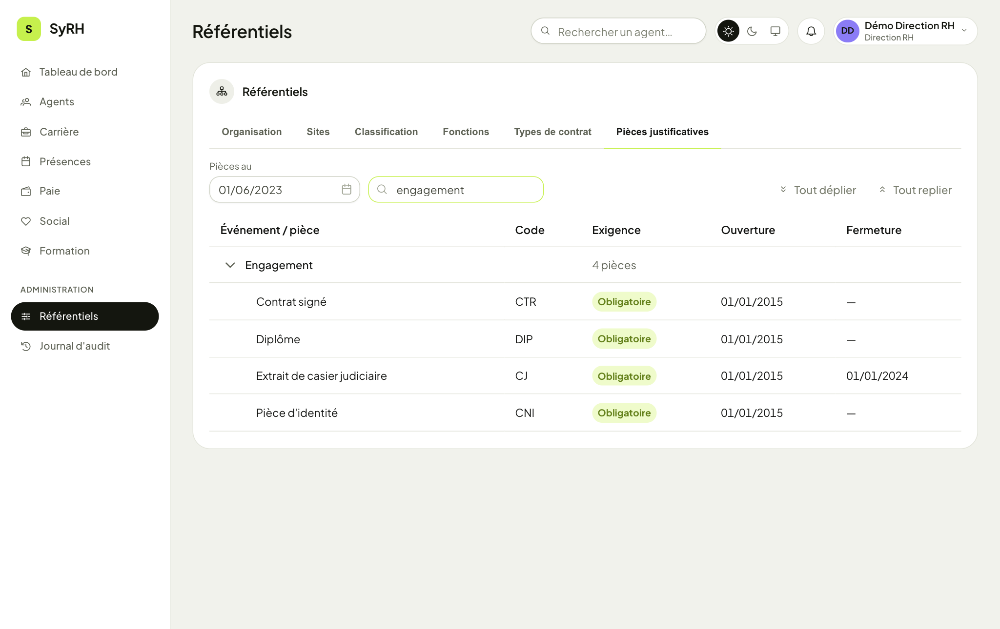

### Sorties et suspensions

The **Sorties et suspensions** tab shows two lists, one above the other.

**Motifs de sortie** are the reasons an agent leaves for good: retirement, resignation, death.
Each one names the **Pièce exigée**, the document the exit rests on (a retirement decision, a
resignation letter, a death certificate). Two tags mark the reasons later steps treat apart:

- **Retraite**: the reason is a retirement; it will count in the retirement forecast and alerts;
- **Décès**: the reason is a death; the final settlement will go to the agent's heirs.

**Positions de suspension** are the positions that pause a career without ending it, such as a
**Mise en disponibilité** or a **Détachement**. For each one:

- **Pièce exigée**: the document the suspension rests on, usually a decision;
- **Compte dans l'ancienneté**: **Oui** if the time spent in this position counts toward
  seniority and the 30 years of career;
- **Durée maximale**: the longest single period, or **Fixée par la décision** when the decision
  sets it;
- **Renouvellements**: how many times a period may be renewed, or **Sans limite**.

These rules will apply when exits and suspensions are recorded for each agent, in a later
version.

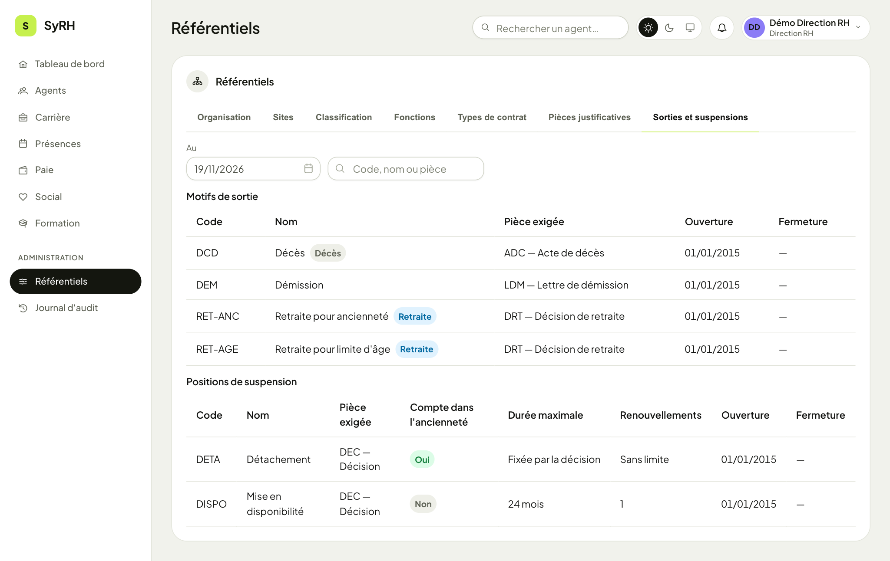

**Search and date.** One search box and one **Au** date serve both lists. The search matches a
code, a name or the required document. Here, "décision" keeps the two retirements and both
suspension positions:

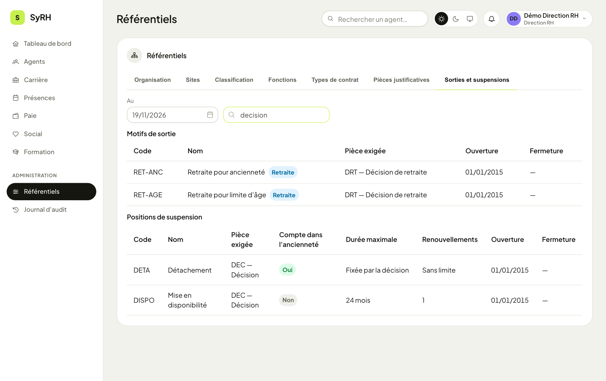

### Banques

The **Banques** tab lists the banks agents can be paid through, in alphabetical order, with their
code, name and **SWIFT/BIC** code, the international identifier used in bank transfers. A dash
means the SWIFT/BIC has not been recorded. Each agent's bank and account number will be recorded
in a later version.

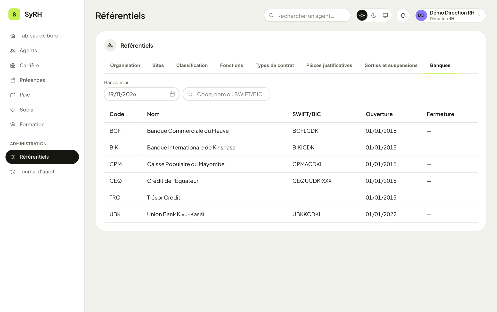

Search by code, name or SWIFT/BIC.

**See the banks at another date.** A bank that is renamed or merged is closed and a new one
opened in its place. Change the **Banques au** date to see the list as it was: in the
demonstration data, the **Union des Banques du Kasaï** became the **Union Bank Kivu-Kasaï** on
1 January 2022, keeping its code.

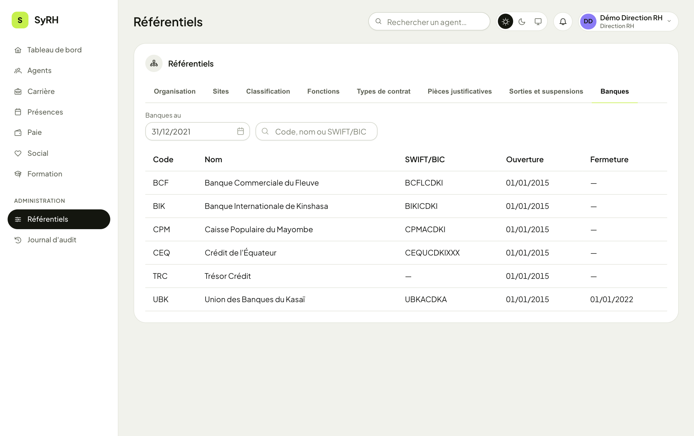

### Paramètres

The **Paramètres** tab shows the numbers SyRH's rules rely on, with their unit:

- **Âge limite des enfants à charge**: the age at which a child stops being a dependant;
- **Nombre maximal d'enfants pris en charge**: how many children at most count for the family
  allowances;
- **Âge de la retraite**: the age at which an agent retires;
- **Durée de carrière avant la retraite**: the years of career, from the hiring date, after which
  an agent retires (whichever of the two comes first).

These values will be used by the dependants, retirement and payroll features of later versions.
A parameter shown as **Non renseigné** has no value at that date.

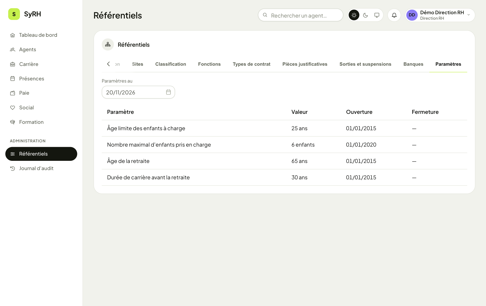

**See the values at another date.** When a value changes, the old one is closed on the day the
new one starts. Change the **Paramètres au** date to see the values as they were: in the
demonstration data, the maximum number of children was 4 until 1 January 2020.

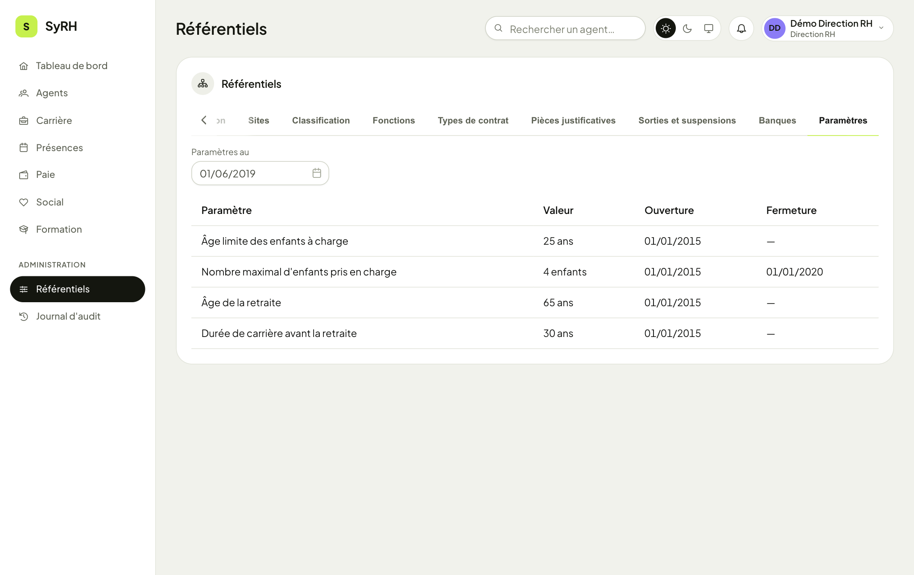

### Change the reference data

If you may change a list, its tab shows an **Ajouter** button and, at the end of each row, a
**⋮** menu. Other users see neither.

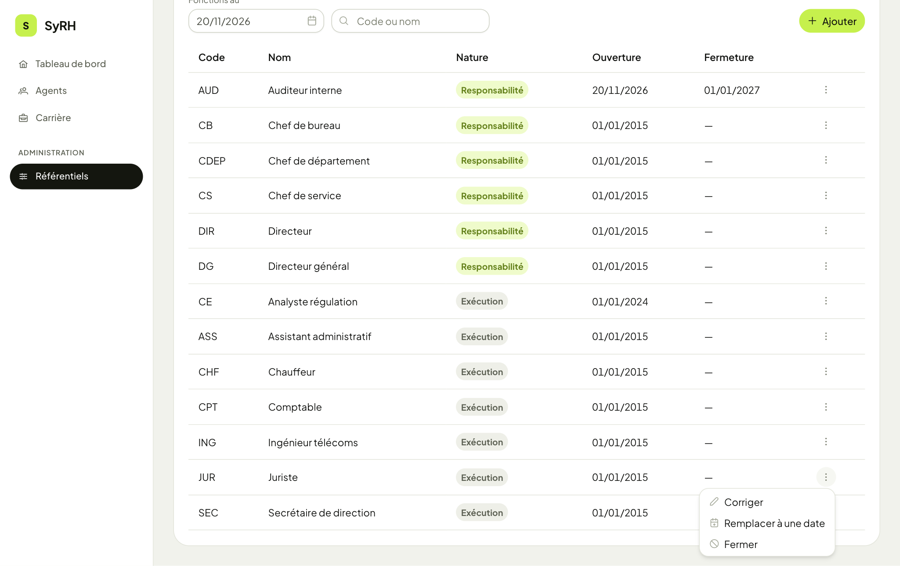

Choose the action that matches what happened:

- **Ajouter**: a new row, for example a new fonction. Fill in the form and click
  **Enregistrer**.
- **Corriger**: fix a typing error in a row. The row is changed in place, as if it had always
  been right.
- **Remplacer à une date**: something really changed, for example a fonction renamed or a new
  retirement age. Give the **Date d'effet** and the new values: the current row closes on that
  day and the new one applies from it, so the old values stay visible at earlier dates.
- **Fermer**: the row no longer applies from a date, with nothing to replace it.

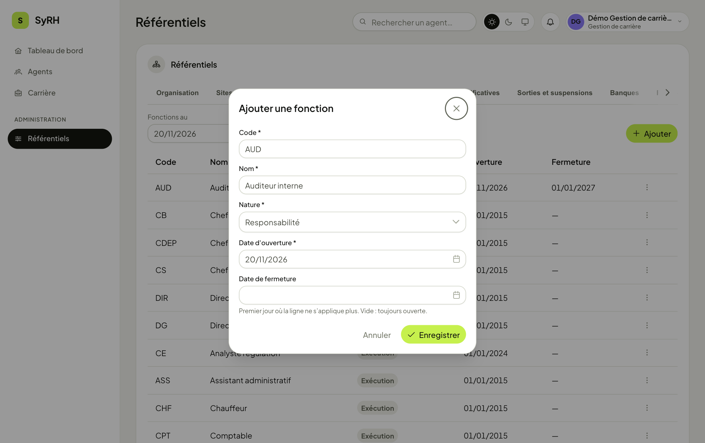

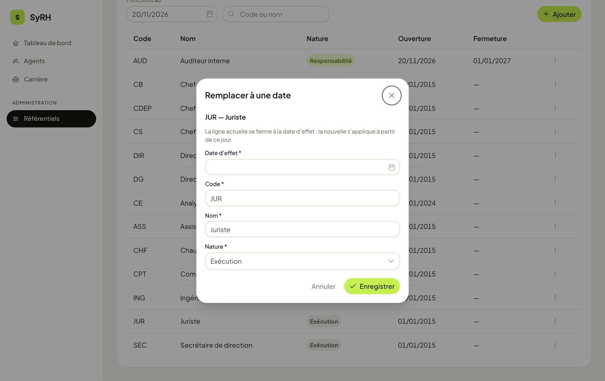

**When SyRH refuses.** The form says what is wrong next to the field concerned, or at the top
when it is about the whole row, for example a code already used by another open row. Nothing is
saved until every message is resolved.

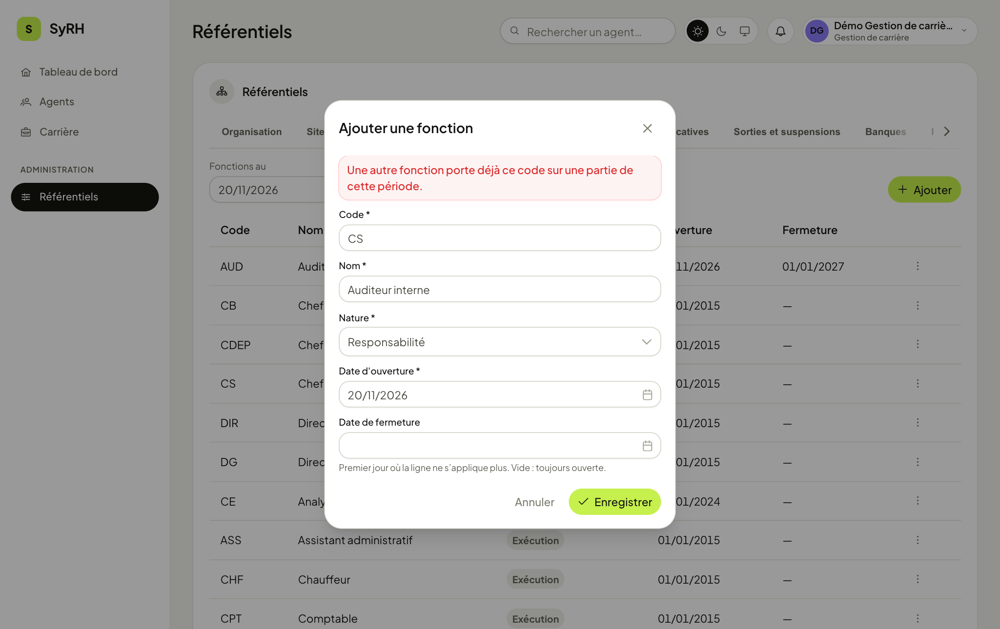

Nothing is ever deleted: a row that no longer applies is closed. Every change is recorded in the
audit log, with your name.

#### In the trees: organisation, classification, documents

The **Organisation**, **Classification** and **Pièces justificatives** tabs work the same way,
with a **+** at the end of a row to add something under it:

- in **Organisation**, **Ajouter une direction** above the tree, and **+** on a unit to add a
  sub-unit: its parent, site and type (the level below) are filled in for you;
- in **Classification**, **Ajouter une catégorie**, then **+** on a catégorie to add a grade, and
  on a grade to add an échelon with the next number;
- in **Pièces justificatives**, **+** on an event to add a document it requires; the document
  types themselves are listed and changed in the **Types de pièce** table under the tree.

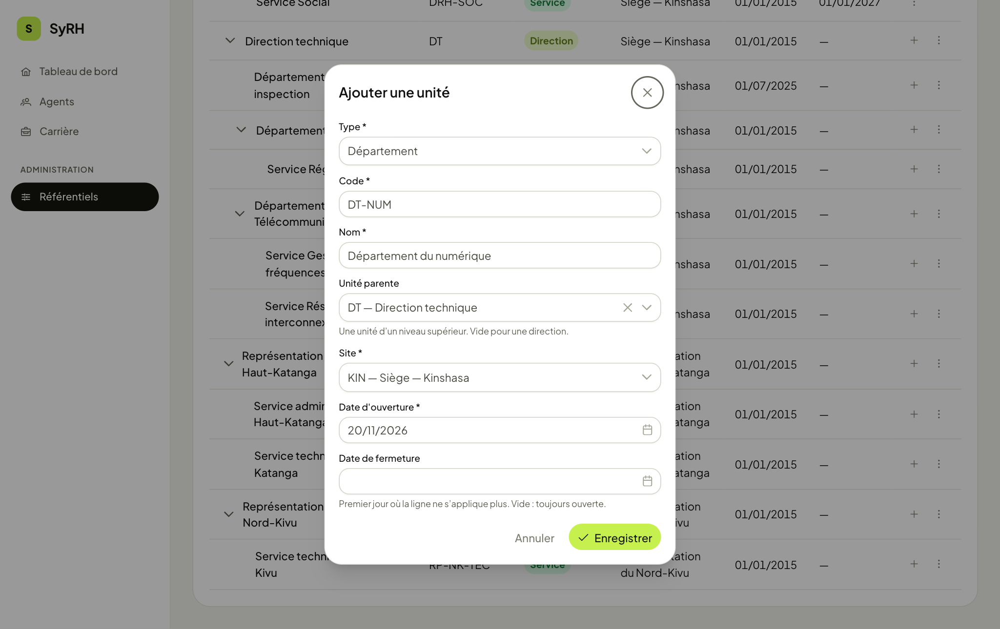

**Replacing a row that has rows under it.** When you replace a direction, a catégorie, a grade or
a document type at a date, everything still open under it follows: the départements, services
and bureaux of the direction, the grades and échelons of the catégorie, the documents required,
exit reasons and suspension positions that use the document type. They close on the same date
and reopen, unchanged, under the new row. Before you save, the form says how many rows will
follow and asks you to confirm:

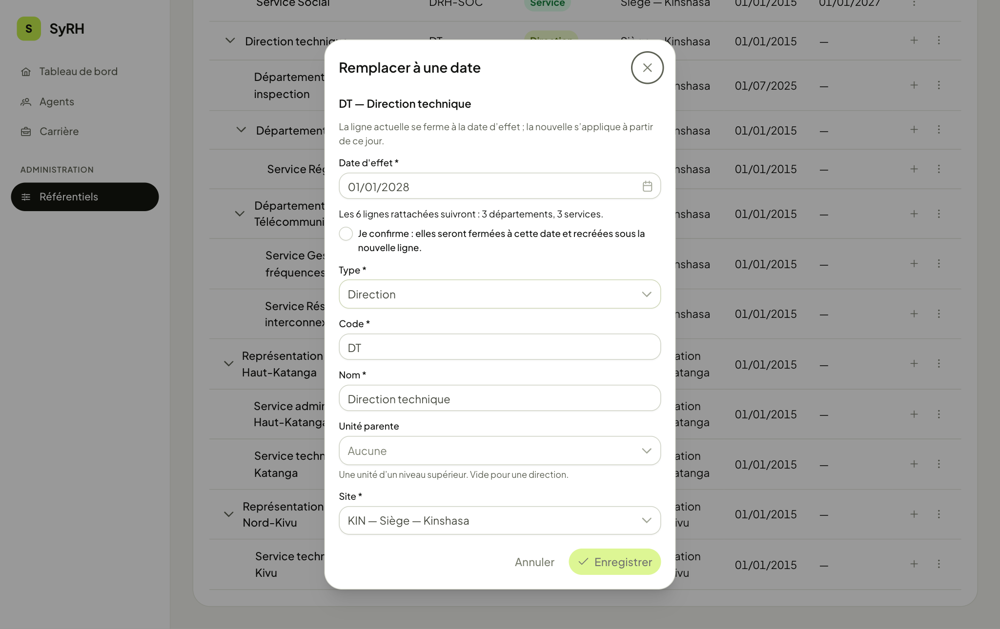

If a row under it only opens on or after that date, the replacement is refused and the form
names it: correct or close that row first.

**Closing is stricter.** **Fermer** on a unit, catégorie, grade or document type that still has
open rows under it is refused, and the message names them: close those first, or replace the row
instead. In the same way, a site cannot close while units on it stay open. A site has no
**Remplacer à une date**: correct it, or close it and add a new one.

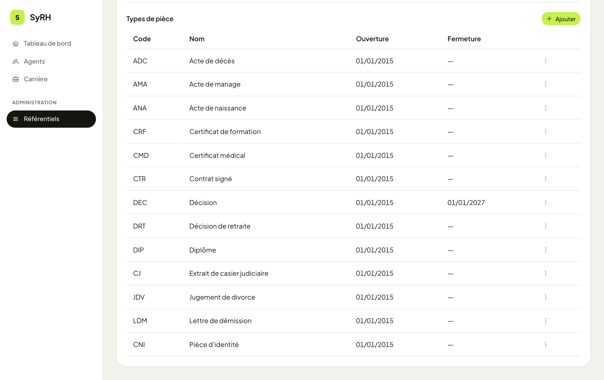

### Who changes the reference data

The **Gestion de carrière** profiles (its agents and its Chef de service) and the
**Administrateur système** change all the reference data in SyRH, as described above. The
**banks** are changed by the **Rémunération** profiles and the **Administrateur système**, not by
Gestion de carrière.

A reorganisation, a reform, a rename or a merger is recorded by closing the old row on a date and
opening the new one, never by deleting it, so the history stays readable. The administration site
(`/admin/`) still offers the same lists to the administrator, as a fallback. Every change is recorded in the
[audit log](#7-the-audit-log-journal-daudit).

## 6. Agents' supporting documents (Pièces des agents)

**Pièces des agents** keeps the scanned copy of each agent's supporting documents: signed
contract, identity document, diploma, decisions, civil-status certificates. Files are PDF, JPEG
or PNG, up to the size set in the **Paramètres** tab (10 Mo in the demonstration). They are stored
encrypted on the server and can only be opened from SyRH, by a signed-in user.

Who can see them: every profile that opens **Agents**. **Gestion de carrière** and
**Administration du personnel** (and their heads of service) also add and retire documents.

### Find an agent's documents

Open **Pièces des agents** in the side menu. In the **Agent** field, type part of the matricule
or of the name, then pick the agent in the list. Their documents show newest first, with the
type, the file name and format, the date printed on the document, the size, and when and by whom
it was added. The address of the page keeps the agent, so you can bookmark it or send it to a
colleague.

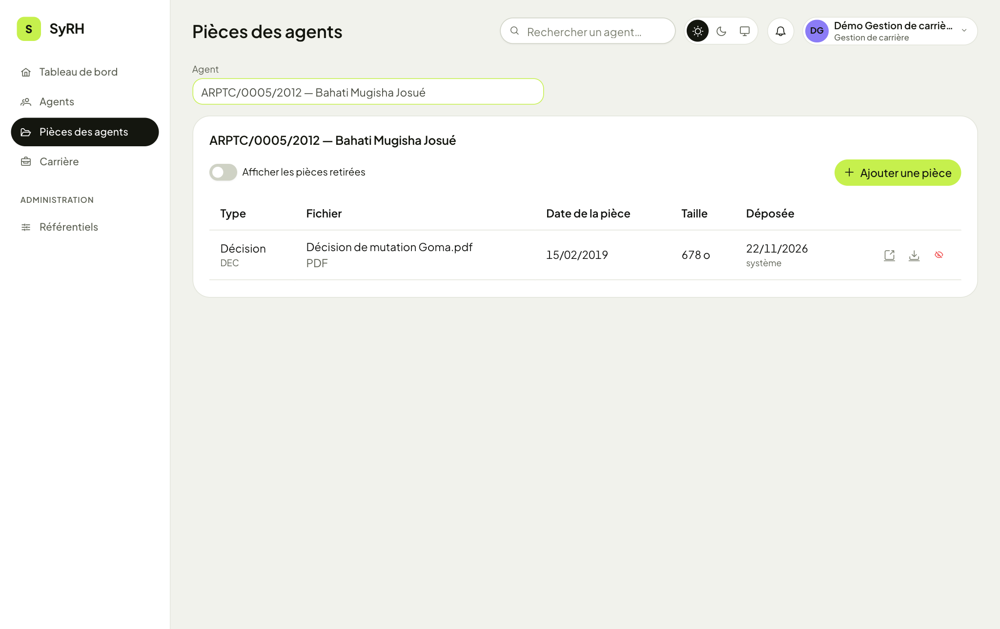

On each row:

- the arrow-out-of-box icon opens the document in a new tab;
- the arrow-down icon downloads it, with its original name;
- the red eye icon retires it (see below), if your profile may.

### Add a document

1. Click **Ajouter une pièce**.
2. Choose the **Type de pièce**. Only the types open today, and that your profile may read, are
   offered.
3. If you wish, give the **Date de la pièce**: the date printed on the document.
4. Click **Choisir un fichier** and pick the scan.
5. Click **Déposer**. A bar shows the progress, then **Pièce déposée** confirms it.

SyRH refuses a file that is not a PDF, JPEG or PNG, an empty file, a file over the size limit,
and the same file already added for this agent with this type. The reason shows under the field.
A file renamed to `.pdf` without being one is refused too: SyRH reads its content, not its name.

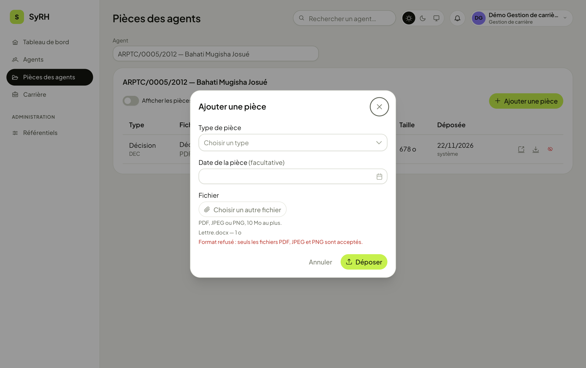

### Retire a document added by mistake

A document is never deleted. If one was added to the wrong agent, with the wrong type, or is
unreadable, retire it: click the red eye icon, give the reason (10 characters at least), then
**Retirer**. It leaves the list but stays on file. Add the right document again if needed.

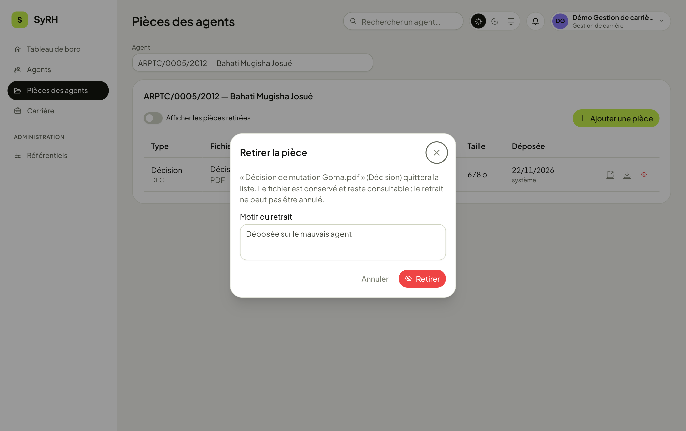

Switch on **Afficher les pièces retirées** to see retired documents, greyed, with the reason, who
retired them and when. They still open. A retirement cannot be undone.

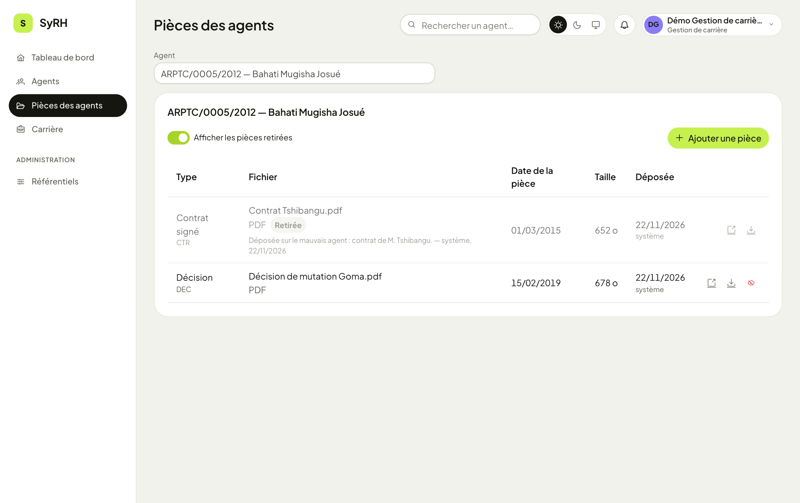

### Confidential documents

Some document types are confidential, for example the medical certificate or the identity
document. A lock shows next to their type. Only the profiles chosen for that type see these
documents at all: for the others, they are simply not in the list. The demonstration reserves the
medical certificate to **Social**, its head of service and **Direction RH**.

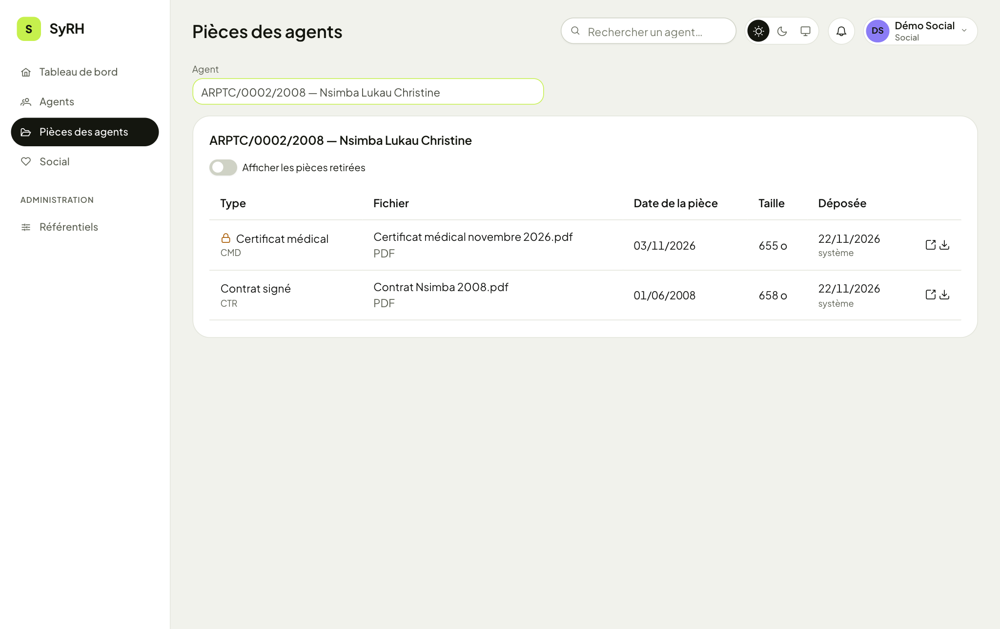

Which types are confidential, and for whom, is set by the administrator of the reference data in
the administration site (`/admin/`, **Types de pièce**).

## 7. The audit log (Journal d'audit)

The **Journal d'audit** records every change made in SyRH: who made it, when, on which record,
and the values before and after. Nobody can change or delete an entry.

Who can open it: **Auditeur**, **Direction RH** and **Administrateur système**. Each sees only
the entries of the modules their profile may open, plus changes to user accounts (**Comptes**).

### Find an entry

Use the filters above the list. You can combine them:

- **Période**: pick a start date and an end date in the calendar;
- **Auteur**: type part of the name of the person who made the change;
- **Module**: for example Référentiels or Comptes;
- **Action**: for example Création (creation) or Modification.

The number of matching entries shows at the top right. Click **Effacer les filtres** to see all
entries again. The newest entries come first. Use the page numbers at the bottom to see older
ones.

### See the detail of a change

Click a row. The **Détail de l'entrée** panel opens on the right, with:

- the action, the record concerned, its table and module;
- the date and time, and the author;
- a table of the fields that changed, with the value **Avant** (before) and **Après** (after).

Passwords are always masked (••••••): the log only records that one changed.

Close the panel with the cross at its top right, or press Échap (Escape).

## 8. System status (Système)

For the **Administrateur système** only. **Système** shows whether the application is running:
the state of the API and the database version. If SyRH cannot reach its server, the page says
**API injoignable** (API unreachable).

The **Design** entry, also for the system administrator, shows the colours and components SyRH is
built with. End users do not need it.

## 9. Using SyRH on a smaller screen

On a narrow window or a tablet, the side menu shrinks to icons. Hover over an icon to see the
module's name. The agent search field is hidden, and the buttons of the Référentiels screen move
to their own line.

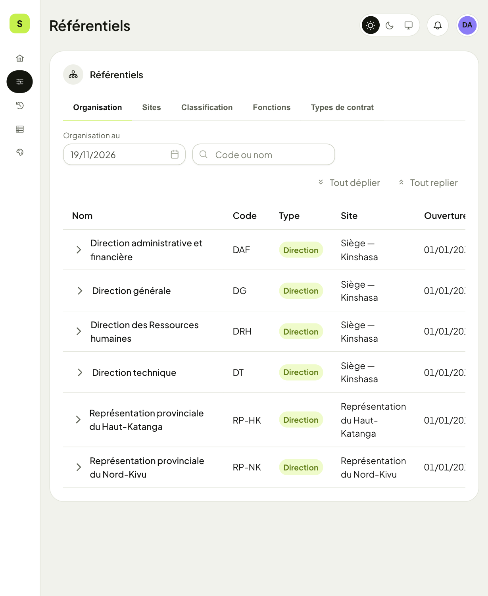

## 10. Common questions

**I forgot my password.**
Ask the system administrator to set a new one, then change it from your account menu
([section 4](#change-your-password)).

**A module I need is not in my menu.**
Your profile does not include it. Ask the system administrator to review your profile.

**I see "Aucun profil ne vous est attribué".**
Your account exists but has no profile yet. Ask the system administrator to give you one.

**A page says it could not load ("n'a pas pu être chargé"), or "Connexion impossible pour le
moment".**
The server did not answer. Wait a moment and try again. If it continues, tell the system
administrator.

**I cannot change anything in Référentiels.**
Only the editors of a list see **Ajouter** and the **⋮** menu: Gestion de carrière and the
Administrateur système for most lists, Rémunération for the banks (see
[Who changes the reference data](#who-changes-the-reference-data)). Ask one of them if a value is
wrong.

**Can I change or delete an audit log entry?**
No. The log is permanent, and nobody can change it, not even the administrator.

---

*Screenshots taken on 19 November 2026 with the demonstration data and accounts
(`create_demo_users`, `create_demo_organisation`, `create_demo_classification`,
`create_demo_fonctions`, `create_demo_types_contrat`, `create_demo_pieces`). To retake them,
see `docs/capture_screenshots.py`.*
